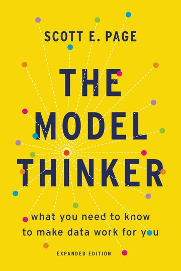

# The Model Thinker Companion

*The Model Thinker (Page, 2018) companion you didn't know you needed.*

**Every model in Scott E. Page's *The Model Thinker*, with its formulation and an interactive application that runs in your browser.**

[](https://app.netlify.com/sites/the-model-thinker-companion/deploys)
[](https://the-model-thinker-companion.netlify.app/#all-models)
[](https://the-model-thinker-companion.netlify.app/agent-based.html)
[](https://quarto.org)

**Visit the site: <https://the-model-thinker-companion.netlify.app>**



In *The Model Thinker* (Basic Books, 2018; expanded edition, 2021), Scott E.
Page argues that making sense of data, and of the world, takes not one model
but many: crowds and categories, bell curves and long tails, networks and
contagions, Markov chains and feedback loops, games, mechanisms and learning
rules, each a different lens. This site is a companion to the book. It gives
each of the book's 55 models its own page, so you can read the model's
formulation, stated precisely, and then move the sliders and watch it work.

> This is an independent study aid and homage. It is not affiliated with,
> endorsed by or reviewed by Scott E. Page or his publisher. The models are
> Page's selection; the explanations, the formulations as typeset here and the
> simulations are ours, and so are any mistakes in them. Nothing from the book's
> text or figures is reproduced; the cover is shown to identify the book. Please
> read the book.

<br clear="right">

## What you'll find

- **55 models**, one page each, in the order the book presents them, from the
  Condorcet jury theorem to the NK model of rugged landscapes. Every page has
  the same shape: *The idea*, a **formulation** box (the setup, the equations
  or rules, and the result), an interactive model, takeaways, uses, related
  models and sources, with the chapter and pages where the book presents it.
- **An interactive application on every page**, with seeded random numbers so
  a given seed always reproduces the same picture, and default settings chosen
  to show the model's point with a typical run, not a lucky one. A summary
  under each chart states the result in words and updates as you move the
  controls.
- **The right tool for each model.** The 48 equation-based models (difference
  and differential equations, closed-form results, Markov chains, games,
  mechanisms, learning rules) are computed live in the browser with
  [Observable JS](https://quarto.org/docs/interactive/ojs/). Each has a
  reference implementation in R, using the package that suits it:
  [deSolve](https://cran.r-project.org/package=deSolve) for differential
  equations, [igraph](https://r.igraph.org) for networks, `lm` for regression
  and base R otherwise.
- **Seven agent-based models built in [NetLogo](https://ccl.northwestern.edu/netlogo/)**
  and run as designed experiments with [nlrx](https://docs.ropensci.org/nlrx/):
  El Farol, the forest fire model, local majority, the Game of Life,
  Granovetter's riots, Schelling's segregation and cooperative action. Their
  pages chart the NetLogo results across parameters and random seeds, next to
  a JavaScript replay of the same rules that you can step through or play.
- **Show model code** under every application, with tabs for the code that
  runs on the page and for the R, NetLogo or nlrx reference.
- **Many-model thinking.** Each page links to related models that complement
  or contrast with it, and a [Many-model thinking](https://the-model-thinker-companion.netlify.app/many-models.html)
  page explains Page's case for using many models and his seven uses of models
  (REDCAPE), which tag every page's *Uses* section.
- **Source checks.** Each formulation was checked against the book's box and
  text. Where the book's box and its worked example disagree, or a printed
  number is off, the page follows the consistent version and says so.
- **Light and dark mode**, keyboard-operable controls, and accessible names and
  descriptions on every chart.

## The models

Nine families follow the arc of the book.

- **[Many models and prediction](https://the-model-thinker-companion.netlify.app/families/many-models.html)** (3): [Condorcet Jury Theorem](https://the-model-thinker-companion.netlify.app/models/condorcet-jury-theorem.html), [Diversity Prediction Theorem](https://the-model-thinker-companion.netlify.app/models/diversity-prediction-theorem.html), [Categorization Models](https://the-model-thinker-companion.netlify.app/models/categorization-models.html).
- **[Modeling people](https://the-model-thinker-companion.netlify.app/families/modeling-people.html)** (3): [Rational-Actor Model](https://the-model-thinker-companion.netlify.app/models/rational-actor.html), [Prospect Theory](https://the-model-thinker-companion.netlify.app/models/prospect-theory.html), [The El Farol Model](https://the-model-thinker-companion.netlify.app/models/el-farol.html) *(agent-based)*.
- **[Distributions](https://the-model-thinker-companion.netlify.app/families/distributions.html)** (5): [Normal Distribution and the Central Limit Theorem](https://the-model-thinker-companion.netlify.app/models/normal-distribution.html), [Lognormal Distribution](https://the-model-thinker-companion.netlify.app/models/lognormal-distribution.html), [Power Laws and Preferential Attachment](https://the-model-thinker-companion.netlify.app/models/power-laws.html), [Forest Fire Model (Self-Organized Criticality)](https://the-model-thinker-companion.netlify.app/models/forest-fire-model.html) *(agent-based)*, [Information Entropy](https://the-model-thinker-companion.netlify.app/models/entropy.html).
- **[Linear and nonlinear models](https://the-model-thinker-companion.netlify.app/families/linear-nonlinear.html)** (3): [Linear Models](https://the-model-thinker-companion.netlify.app/models/linear-models.html), [Exponential Growth](https://the-model-thinker-companion.netlify.app/models/exponential-growth.html), [Simple and Solow Growth Models](https://the-model-thinker-companion.netlify.app/models/growth-models.html).
- **[Value and power](https://the-model-thinker-companion.netlify.app/families/value-power.html)** (5): [Shapley Value](https://the-model-thinker-companion.netlify.app/models/shapley-value.html), [Shapley–Shubik Index](https://the-model-thinker-companion.netlify.app/models/shapley-shubik-index.html), [Auctions and Revenue Equivalence](https://the-model-thinker-companion.netlify.app/models/auctions.html), [Public Projects and the Pivot Mechanism](https://the-model-thinker-companion.netlify.app/models/pivot-mechanism.html), [Signaling Models](https://the-model-thinker-companion.netlify.app/models/signaling.html).
- **[Networks and contagion](https://the-model-thinker-companion.netlify.app/families/networks-contagion.html)** (9): [Network Structures and Statistics](https://the-model-thinker-companion.netlify.app/models/network-structure.html), [Quality and Degree Network Formation](https://the-model-thinker-companion.netlify.app/models/network-formation.html), [Friendship Paradox](https://the-model-thinker-companion.netlify.app/models/friendship-paradox.html), [Six Degrees of Separation](https://the-model-thinker-companion.netlify.app/models/six-degrees.html), [Network Robustness](https://the-model-thinker-companion.netlify.app/models/network-robustness.html), [Broadcast Model](https://the-model-thinker-companion.netlify.app/models/broadcast-model.html), [Diffusion Model](https://the-model-thinker-companion.netlify.app/models/diffusion-model.html), [The Bass Model](https://the-model-thinker-companion.netlify.app/models/bass-model.html), [SIR Model](https://the-model-thinker-companion.netlify.app/models/sir-model.html).
- **[Processes and dynamics](https://the-model-thinker-companion.netlify.app/families/processes-dynamics.html)** (12): [Bernoulli Urn Model](https://the-model-thinker-companion.netlify.app/models/bernoulli-urn.html), [Random Walk](https://the-model-thinker-companion.netlify.app/models/random-walk.html), [Polya Process](https://the-model-thinker-companion.netlify.app/models/polya-process.html), [Balancing Process](https://the-model-thinker-companion.netlify.app/models/balancing-process.html), [Local Majority Model](https://the-model-thinker-companion.netlify.app/models/local-majority.html) *(agent-based)*, [Game of Life](https://the-model-thinker-companion.netlify.app/models/game-of-life.html) *(agent-based)*, [Lyapunov Functions](https://the-model-thinker-companion.netlify.app/models/lyapunov-functions.html), [Markov Models](https://the-model-thinker-companion.netlify.app/models/markov-models.html), [Lotka–Volterra Model](https://the-model-thinker-companion.netlify.app/models/lotka-volterra.html), [Granovetter's Riot Model](https://the-model-thinker-companion.netlify.app/models/riot-model.html) *(agent-based)*, [Schelling's Segregation Model](https://the-model-thinker-companion.netlify.app/models/schelling-segregation.html) *(agent-based)*, [Ping-Pong Model](https://the-model-thinker-companion.netlify.app/models/ping-pong-model.html).
- **[Games and cooperation](https://the-model-thinker-companion.netlify.app/families/games-cooperation.html)** (10): [Spatial Competition Model](https://the-model-thinker-companion.netlify.app/models/spatial-competition.html), [Hedonic Competition Model](https://the-model-thinker-companion.netlify.app/models/hedonic-competition.html), [Zero-Sum Games](https://the-model-thinker-companion.netlify.app/models/zero-sum-games.html), [Sequential Games](https://the-model-thinker-companion.netlify.app/models/sequential-games.html), [The Effort Game](https://the-model-thinker-companion.netlify.app/models/effort-game.html), [Repeated Prisoners' Dilemma](https://the-model-thinker-companion.netlify.app/models/prisoners-dilemma.html), [Cooperative Action Model](https://the-model-thinker-companion.netlify.app/models/cooperative-action.html) *(agent-based)*, [Collective Action and Public Goods](https://the-model-thinker-companion.netlify.app/models/public-goods.html), [Congestion Model](https://the-model-thinker-companion.netlify.app/models/congestion-model.html), [Renewable Resource Extraction](https://the-model-thinker-companion.netlify.app/models/renewable-resource.html).
- **[Learning and search](https://the-model-thinker-companion.netlify.app/families/learning-search.html)** (5): [Reinforcement Learning](https://the-model-thinker-companion.netlify.app/models/reinforcement-learning.html), [Replicator Dynamics](https://the-model-thinker-companion.netlify.app/models/replicator-dynamics.html), [The Generous/Spiteful Game](https://the-model-thinker-companion.netlify.app/models/generous-spiteful-game.html), [Multi-Armed Bandits](https://the-model-thinker-companion.netlify.app/models/multi-armed-bandits.html), [NK Model (Rugged Landscapes)](https://the-model-thinker-companion.netlify.app/models/nk-model.html).

Chapter 29 of the expanded edition (opioids, COVID-19 and inequality) applies
the earlier models to three problems; it is not covered yet.

## Contributing

Corrections are the most useful contribution, especially where a page claims
more than the book supports. Every page on the site has **Report an issue** and
**Edit this page** links that come straight here.

- **Found a mistake?** [Open an issue](https://github.com/nelsonamayad/the-model-thinker-companion/issues)
  with the model's name and what is wrong.
- **Want to fix it yourself?** Edit the model's page under `models/` and open a
  pull request. There is no automatic check yet, so please run the checks below
  first.
- **Adding or rewriting a model?** Start from `_template.qmd`. The conventions
  (page structure, the rules about the book's copyright, how the applications,
  R scripts and NetLogo experiments are written) are documented in
  [CLAUDE.md](CLAUDE.md).

## Run it locally

You need [Quarto](https://quarto.org/docs/get-started/) 1.12 or later and
Python 3. The optional checks also use Google Chrome and R (with deSolve and
igraph); rerunning the agent-based experiments needs
[NetLogo 6.4](https://ccl.northwestern.edu/netlogo/) and the R package
[nlrx](https://docs.ropensci.org/nlrx/).

```bash
git clone https://github.com/nelsonamayad/the-model-thinker-companion.git
cd the-model-thinker-companion
quarto preview                      # live-reloading local server
```

Before opening a pull request, run the checks:

```bash
python scripts/check_models.py      # front matter, sections, chart labels, links, reference scripts
python scripts/run_r.py             # runs every R reference script
quarto render                       # builds the site into _site/
python scripts/check_pages.py       # loads every page in headless Chrome
```

After adding a model or changing a model's front matter, its application's
cells, its R script or its NetLogo files, run `python scripts/build_site.py`:
it regenerates the family pages, the home-page cards, the sidebar, each page's
source callout and its code tabs. To rerun the NetLogo experiments, run
`python scripts/run_abm.py` (minutes per model); the results land in `data/`.

## How it's built

- [Quarto](https://quarto.org) renders the site; a single `_brand.yml` holds the
  colors, fonts and light and dark themes.
- The applications are [Observable JS](https://observablehq.com/documentation/cells/observable-javascript)
  drawn with [Observable Plot](https://observablehq.com/plot/), sharing one
  library, `js/models.js`, for seeded random numbers, distributions,
  regression, a Runge–Kutta integrator, Markov chains, network generators and
  statistics, grid drawing and the play/step control.
- The agent-based models are NetLogo 6.4 models, run headless by
  [nlrx](https://docs.ropensci.org/nlrx/) experiments (full-factorial designs
  over parameters and seeds). Their results are committed as CSV files, so
  building the site needs neither R nor NetLogo.

| Path | What it is |
|---|---|
| `models/*.qmd` | One page per model (follow `_template.qmd`) |
| `R/*.R` | R reference implementations of the equation-based models |
| `abm/*.nlogo`, `abm/*.R`, `abm/_nlrx.R` | NetLogo models, their nlrx experiments and the shared nlrx setup |
| `data/*.csv` | Results of the NetLogo experiments, charted on the agent-based pages |
| `js/models.js` | Shared helpers imported by every model page |
| `families/*.qmd`, `agent-based.qmd`, `_sidebar.yml`, `_family-cards.md` | Generated by `scripts/build_site.py`; don't edit by hand |
| `scripts/` | `build_site.py`, `check_models.py`, `check_pages.py`, `run_r.py`, `run_abm.py` |
| `_quarto.yml`, `_brand.yml`, `styles.css` | Site structure, brand and styling |
| `_publish.yml` | The Netlify site that `quarto publish netlify` deploys to |

## For maintainers: publishing

The site is published to the Netlify site recorded in `_publish.yml`. Render,
run the checks, then:

```bash
quarto publish netlify --no-render --no-prompt --no-browser
```

There is no GitHub Actions workflow yet, so pushes to `main` do not deploy by
themselves.

## Credits and license

Built by [Nelson Amaya D](https://github.com/nelsonamayad) with Claude Opus 5.5
(Anthropic) through Claude Code. The About page on the site describes how.
Modelled on the sibling project, the
[Andrew Gelman Statistical Lexicon Explorer](https://github.com/nelsonamayad/gelman-lexicon-explorer).

- *The Model Thinker* and its cover belong to Scott E. Page and his publisher.
  Cover design by Chin-Yee Lai; cover © 2021 Hachette Book Group. The cover is
  shown at small size to identify the book.
- NetLogo: Uri Wilensky (1999), Center for Connected Learning and
  Computer-Based Modeling, Northwestern University. The NetLogo models here are
  our own code.
- nlrx: Salecker, Sciaini, Meyer and Wiegand, *Methods in Ecology and Evolution*
  10 (2019), [doi:10.1111/2041-210X.13286](https://doi.org/10.1111/2041-210X.13286).
- A license for the code and the explanations has not been chosen yet.
