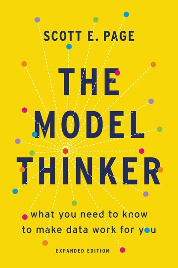

:::: {.hero-wrap}
::: {.hero}
In *The Model Thinker* (2018), Scott E. Page is like a greatest hits album for social science. It collects almost 30 models, and describes even very complicated topics, like mechanism design, in an intuitive and clear way. 

I always felt this book missed using digital tools to visualize and play around with the models, so I built this site to fill the gap. It extends each model's **formulation** (the assumptions, variables and equations, with an **interactive application** you can run in your browser.

Each model is built with the tool that suits it. Equation-based models are computed live as you move the sliders. **Agent-based models** are written in [NetLogo](https://ccl.northwestern.edu/netlogo/) and run as designed experiments with [nlrx](https://docs.ropensci.org/nlrx/); their pages chart those results and replay the same rules so you can watch a run unfold.

[Many-model thinking](many-models.qmd){.btn .btn-primary .me-2} [Agent-based models](agent-based.qmd){.btn .btn-outline-primary .me-2} [Random model](random.qmd){.btn .btn-outline-primary .me-2} [About this site](about.qmd){.btn .btn-link}

[Version 0.1, 13 November 2026.]{.site-version}
:::

::: {.hero-cover}
```{=html}
<a href="https://www.basicbooks.com"></a>
```

[*The Model Thinker*, expanded edition (Basic Books, 2021). Cover design by Chin-Yee Lai; cover © 2021 Hachette Book Group.]{.cover-credit}
:::
::::

## Browse by family {#families}

Families follow the arc of the book, from many-model reasoning to learning and search. Every model belongs to exactly one.



## Every model {#all-models}

Models are numbered in the order the book presents them. Type in the filter box to search, click a column header to sort, or click a family or "Agent-based" tag to filter.

::: {#all-models}
:::
